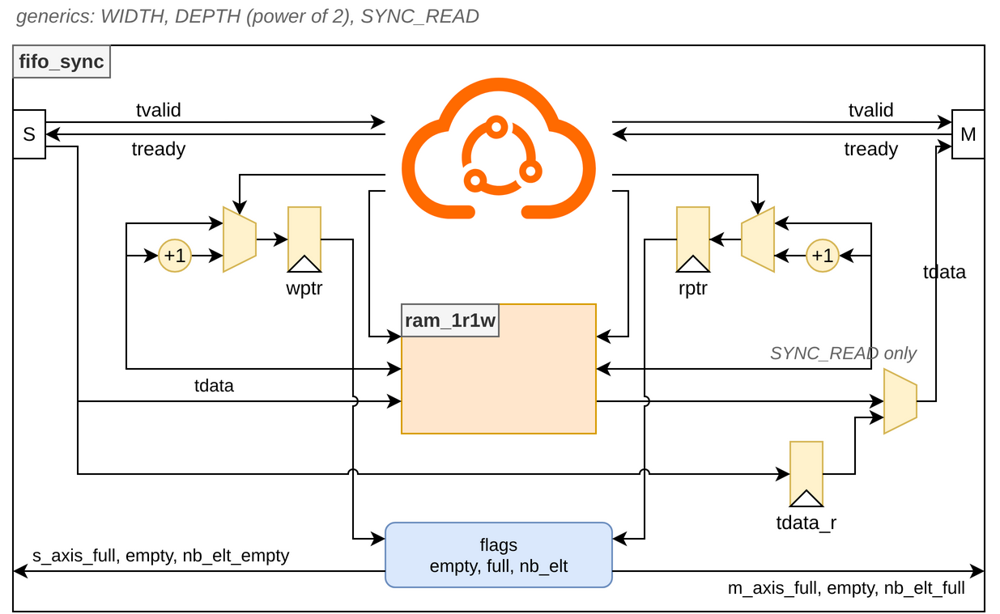
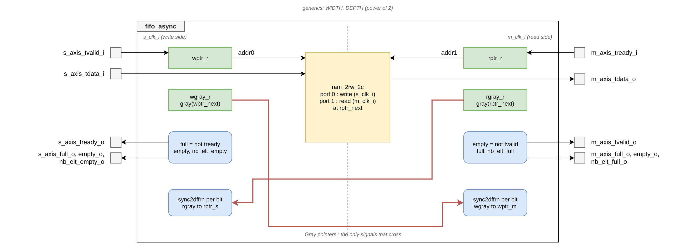

<!--
  README MODEL (common to every Asylum IP, keep the same headings)
  ----------------------------------------------------------------
  Regenerate from the sources, never from the previous README text alone:
    hdl/*.vhd (entities, generics, ports), hdl/csr/*.hjson (register map),
    <IP>.core (VLNV, targets, depends), mk/targets.txt, sim/, syn/, esw/.
  Sections, in this order:
    badges / title + one-line pitch / Overview / Features / Block Diagram /
    Getting Started / Hardware Interfaces / Configuration / Resources /
    Theory of Operation / Registers / Programmer's Guide /
    Design Verification / Dependencies and Related IPs / License
  Rules:
    - English, short and factual: every statement backed by the sources.
    - No VLNV line: the version badge shows it.
    - Badges: first line version, license; second line CI, lint, sim, syn.
    - Block diagram and FSM: pages Overview and FSM of doc/<NAME>.drawio, exported to
      doc/<NAME>-Overview.png and doc/<NAME>-FSM.png (make -C doc).
    - Timing diagrams: WaveDrom source doc/<NAME>-<what>.json, rendered
      doc/<NAME>-<what>.svg (make -C doc), shown as images.
    - No CPU named (OpenBlaze, PicoBlaze, RISC-V) outside the CPU and SoC IPs.
    - Registers: link to the generated hdl/csr/<X>_csr.md, never copy the tables.
    - Tables: Configuration = Name|Type|Default|Description,
      Hardware Interfaces = Name|Direction|Type|Description, grouped by interface.
    - A section with nothing to say is one line ("This IP has no
      software-visible registers."), never removed.
-->
[](https://github.com/deuskane/asylum-component-fifo/tags)
[](LICENSE)

[](https://github.com/deuskane/asylum-component-fifo/actions/workflows/ci.yml)
[](https://github.com/deuskane/asylum-component-fifo/actions/workflows/ci.yml)
[](https://github.com/deuskane/asylum-component-fifo/actions/workflows/ci.yml)
[](https://github.com/deuskane/asylum-component-fifo/actions/workflows/ci.yml)

# FIFO

**Small, readable FIFOs in VHDL: a synchronous FIFO and a dual-clock FIFO, AXI-Stream valid / ready on both sides, full / empty flags and fill levels.**

Part of the [Asylum project](https://github.com/deuskane/asylum-project), a collection of small IP cores, written to be read and learned from.

## Table of Contents

1. [Overview](#overview)
2. [Features](#features)
3. [Block Diagram](#block-diagram)
4. [Getting Started](#getting-started)
5. [Hardware Interfaces](#hardware-interfaces)
6. [Configuration](#configuration)
7. [Resources](#resources)
8. [Theory of Operation](#theory-of-operation)
9. [Registers](#registers)
10. [Programmer's Guide](#programmers-guide)
11. [Design Verification](#design-verification)
12. [Dependencies and Related IPs](#dependencies-and-related-ips)
13. [License](#license)

## Overview

`fifo_sync` is the FIFO of the Asylum IPs: a producer writes words on one side, a consumer reads them in the same order on the other side, both in the same clock domain. The words are stored in a `ram_1r1w` (core `asylum:component:ram`) addressed by a write pointer and a read pointer. Each pointer has one extra bit, the lap bit, which tells a full FIFO from an empty one.

Both sides use AXI-Stream-like valid / ready handshakes, and both see the full / empty flags and a fill level. The `SYNC_READ` generic selects a RAM with an asynchronous read (distributed RAM, flip-flops) or a synchronous read (block RAM friendly), with the same timing on the interfaces.

`fifo_async` has the same ports with **one clock per side** (`s_clk_i` for the write side, `m_clk_i` for the read side, unrelated clocks): the words are stored in a `ram_2rw_2c` (one port per clock), and each side sends its pointer to the other one in Gray code through 2 flip-flop synchronizers, the only signals that cross the clock domains (see [fifo_async (two clocks)](#fifo_async-two-clocks)).

## Features

- Single clock domain (`clk_i`), asynchronous active-low reset (`arst_b_i`)
- Generic word width (`WIDTH`) and depth (`DEPTH`, a power of 2, 1 included)
- Write side: `s_axis_tvalid_i` / `s_axis_tready_o` / `s_axis_tdata_i`, `s_axis_tready_o = not full`
- Read side: `m_axis_tvalid_o` / `m_axis_tready_i` / `m_axis_tdata_o`, `m_axis_tvalid_o = not empty`; `m_axis_tdata_o` holds the oldest word as long as `m_axis_tvalid_o = 1`
- Full and empty flags on both sides, number of free words (`s_axis_nb_elt_empty_o`) and of stored words (`m_axis_nb_elt_full_o`)
- One write and one read per cycle; a word written is readable in the next cycle
- `SYNC_READ = true`: synchronous RAM read, with an output register for a written word that becomes the head at once
- Simulation only: assertion `nb_elt_full + nb_elt_empty = DEPTH` on every clock edge
- `fifo_async`: write side on `s_clk_i`, read side on `m_clk_i` (unrelated clocks), the same AXI-Stream ports, flags and fill levels; storage `ram_2rw_2c`, Gray pointers (`gray_pkg`) through `sync2dffrn`, reset released on each clock; a transfer is seen by the other side 1 to 2 cycles of its clock later, with no further edge of the clock of the transfer (it may stop, as a JTAG TCK)
- Component declarations in `asylum.fifo_pkg`

## Block Diagram



- `wptr` and `rptr` are `clog2(DEPTH)+1`-bit counters, incremented on a write handshake (`s_axis_tvalid_i and s_axis_tready_o`) and on a read handshake (`m_axis_tvalid_o and m_axis_tready_i`).
- `ins_RAM` (`ram_1r1w`) is written at `wptr` with `s_axis_tdata_i` on every write handshake.
- The flag logic compares the two pointers: empty, full and the two fill levels.
- `SYNC_READ = true` only: `tdata_r` captures a written word that becomes the head before the RAM can return it, and the output mux selects it.



- `fifo_async`: the write side (`wptr_r`, `wgray_r`, its flags) runs on `s_clk_i`, the read side (`rptr_r`, `rgray_r`, its flags) on `m_clk_i`; `ram_2rw_2c` is written by port 0 on `s_clk_i` and read by port 1 on `m_clk_i`. The two Gray pointers (red) are the only signals that cross, each through one `sync2dffrn` per bit.

## Getting Started

The cores of the Asylum IPs are published in the FuseSoC library [asylum-cores](https://github.com/deuskane/asylum-cores) (with the UVVM core used by the testbench):

```bash
pip install fusesoc
fusesoc library add https://github.com/deuskane/asylum-cores
fusesoc run --target sim_fifo_depth8_read_sync_push_pop asylum:component:fifo  # needs GHDL
```

To use the IP in your design, add `asylum:component:fifo` to the `depend` list of your core and instantiate `fifo_sync` (library `asylum`):

```vhdl
library asylum;
use     asylum.fifo_pkg.all;

  ins_fifo : fifo_sync
    generic map
    (WIDTH                 => 16
    ,DEPTH                 => 32
    ,SYNC_READ             => true
    )
    port map
    (clk_i                 => clk
    ,arst_b_i              => arst_b
    ,s_axis_tvalid_i       => producer_valid
    ,s_axis_tready_o       => producer_ready
    ,s_axis_tdata_i        => producer_data    -- std_logic_vector(16-1 downto 0)
    ,s_axis_nb_elt_empty_o => fifo_nb_free     -- std_logic_vector( 6-1 downto 0)
    ,s_axis_full_o         => fifo_full
    ,s_axis_empty_o        => open
    ,m_axis_tvalid_o       => consumer_valid
    ,m_axis_tready_i       => consumer_ready
    ,m_axis_tdata_o        => consumer_data    -- std_logic_vector(16-1 downto 0)
    ,m_axis_nb_elt_full_o  => fifo_nb_used     -- std_logic_vector( 6-1 downto 0)
    ,m_axis_full_o         => open
    ,m_axis_empty_o        => fifo_empty
    );
```

`fifo_async` has the same ports with `s_clk_i` and `m_clk_i` instead of `clk_i`, and no `SYNC_READ`:

```vhdl
  ins_fifo_cdc : fifo_async
    generic map
    (WIDTH                 => 16
    ,DEPTH                 => 32
    )
    port map
    (arst_b_i              => arst_b           -- both sides
    ,s_clk_i               => clk_producer
    ,s_axis_tvalid_i       => producer_valid
    ,s_axis_tready_o       => producer_ready
    ,s_axis_tdata_i        => producer_data
    ,s_axis_nb_elt_empty_o => open
    ,s_axis_full_o         => open
    ,s_axis_empty_o        => open
    ,m_clk_i               => clk_consumer
    ,m_axis_tvalid_o       => consumer_valid
    ,m_axis_tready_i       => consumer_ready
    ,m_axis_tdata_o        => consumer_data
    ,m_axis_nb_elt_full_o  => open
    ,m_axis_full_o         => open
    ,m_axis_empty_o        => open
    );
```

## Hardware Interfaces

Entities `fifo_sync` ([hdl/fifo_sync.vhd](hdl/fifo_sync.vhd)) and `fifo_async` ([hdl/fifo_async.vhd](hdl/fifo_async.vhd)), components in `asylum.fifo_pkg` ([hdl/fifo_pkg.vhd](hdl/fifo_pkg.vhd)). The tables are those of `fifo_sync`; `fifo_async` differs as below.

### Clock and Reset

| Name | Direction | Type | Description |
|------|-----------|------|-------------|
| `clk_i` | in | std_logic | Clock |
| `arst_b_i` | in | std_logic | Asynchronous reset, active low: empties the FIFO (pointers, output register); the RAM content is not reset |

### Write side (AXI-Stream slave)

| Name | Direction | Type | Description |
|------|-----------|------|-------------|
| `s_axis_tvalid_i` | in | std_logic | Write request |
| `s_axis_tready_o` | out | std_logic | FIFO not full: the word is written when `s_axis_tvalid_i = 1` |
| `s_axis_tdata_i` | in | std_logic_vector(WIDTH-1 downto 0) | Word to write |
| `s_axis_nb_elt_empty_o` | out | std_logic_vector(clog2(DEPTH) downto 0) | Number of free words |
| `s_axis_full_o` | out | std_logic | FIFO full |
| `s_axis_empty_o` | out | std_logic | FIFO empty |

### Read side (AXI-Stream master)

| Name | Direction | Type | Description |
|------|-----------|------|-------------|
| `m_axis_tvalid_o` | out | std_logic | FIFO not empty: `m_axis_tdata_o` is the oldest word |
| `m_axis_tready_i` | in | std_logic | Read acknowledge: the word is removed when `m_axis_tvalid_o = 1` |
| `m_axis_tdata_o` | out | std_logic_vector(WIDTH-1 downto 0) | Oldest word, meaningful only when `m_axis_tvalid_o = 1` |
| `m_axis_nb_elt_full_o` | out | std_logic_vector(clog2(DEPTH) downto 0) | Number of stored words |
| `m_axis_full_o` | out | std_logic | FIFO full (same signal as `s_axis_full_o`) |
| `m_axis_empty_o` | out | std_logic | FIFO empty (same signal as `s_axis_empty_o`) |

### `fifo_async`

| Name | Direction | Type | Description |
|------|-----------|------|-------------|
| `arst_b_i` | in | std_logic | Asynchronous reset of both sides, active low, released at any time: each side resynchronizes it (asynchronous assertion, release on the second edge of its own clock); `s_axis_tready_o = 0` while the write side is in reset |
| `s_clk_i` | in | std_logic | Clock of the write side (`s_axis_*`) |
| `m_clk_i` | in | std_logic | Clock of the read side (`m_axis_*`) |
| `s_axis_*` | | | As `fifo_sync`, on `s_clk_i`. `s_axis_full_o` (`not s_axis_tready_o`) is exact; `s_axis_empty_o` and `s_axis_nb_elt_empty_o` are pessimistic: a word read is seen as a free place 1 to 2 cycles of `s_clk_i` later |
| `m_axis_*` | | | As `fifo_sync`, on `m_clk_i`. `m_axis_empty_o` (`not m_axis_tvalid_o`) is exact; `m_axis_full_o` and `m_axis_nb_elt_full_o` are pessimistic: a word written is seen 1 to 2 cycles of `m_clk_i` later |

## Configuration

| Name | Type | Default | Description |
|------|------|---------|-------------|
| `WIDTH` | natural | `8` | Word width in bits |
| `DEPTH` | natural | `4` | Number of words, a power of 2 (the pointers wrap at `2**clog2(DEPTH)`; `ram_1r1w` reports an error in simulation for another value) |
| `SYNC_READ` | boolean | `false` | `false`: asynchronous RAM read; `true`: synchronous RAM read and output register. `fifo_sync` only (`fifo_async` always reads `ram_2rw_2c` one cycle ahead) |

## Resources

Figures of the `syn_*` targets (`make nonreg_syn`, see [Targets](#targets)): `fifo_sync` with the generics of each configuration (`WIDTH = 8` in all), synthesized by Yosys and its GHDL plugin; the reports are in the build directory of each target.

| Configuration | LUT¹ | LUTRAM¹ | FF¹ | CARRY4¹ | MUXF7/F8¹ | BRAM¹ | DSP¹ | Area² (µm²) | kGE³ |
|---|---|---|---|---|---|---|---|---|---|
| `syn_default` (`DEPTH` 4, asynchronous read) | 11 | 8 | 6 | 4 | 2 | 0 | 0 | 1570.26 | 0.418 |
| `syn_depth1_read_async` | 6 | 0 | 10 | 0 | 0 | 0 | 0 | 336.57 | 0.090 |
| `syn_depth1_read_sync` | 15 | 0 | 27 | 0 | 0 | 0 | 0 | 1000.96 | 0.267 |
| `syn_depth8_read_async` | 15 | 8 | 8 | 4 | 0 | 0 | 0 | 3017.89 | 0.804 |
| `syn_depth8_read_sync` | 28 | 8 | 25 | 4 | 1 | 0 | 0 | 3739.84 | 0.996 |
| `syn_async_default` (`fifo_async`, `DEPTH` 4) ⁴ | 38 | 8 | 34 | 4 | 4 | 0 | 0 | 2366.02 | 0.630 |
| `syn_async_depth16` (`fifo_async`) ⁴ | 51 | 8 | 50 | 8 | 2 | 0 | 0 | 6975.44 | 1.858 |

¹ Xilinx Artix-7 (LUT6), Yosys 0.33 `synth_xilinx -flatten -noiopad -noclkbuf`, before place and route: every cell of the netlist is counted, Vivado may differ. Identical cells are merged as a vendor tool does (`opt_merge -share_all`): the inverters of an active-low reset net become one; every remaining cell is counted, an `INV` as a `LUT1` (1 to 4 of the LUTs above). With 4 and 8 words the storage is in LUTRAM (two `RAM32M`), not in BRAM; with 1 word it is 8 flip-flops. `SYNC_READ = true` adds the RAM read register, the output register `tdata_r` and its valid bit (`2 x WIDTH + 1` flip-flops).

² SkyWater sky130 `sky130_fd_sc_hd`, typical corner (tt, 25 °C, 1.80 V), Yosys 0.33 `synth` + `dfflibmap` + `abc -liberty`: standard-cell area only, no timing constraint, no buffering, clock tree or placement; the storage becomes flip-flops (no SRAM macro).

³ Area in thousands of NAND2 gate equivalents (`sky130_fd_sc_hd__nand2_1` = 3.7536 µm²).

⁴ `fifo_async`: the flip-flops are the two pointers and their Gray registers (`clog2(DEPTH)+1` bits each, four of them), the two synchronizers (2 per Gray bit) and the registered read data (`WIDTH`). Only port 0 of `ram_2rw_2c` writes: Yosys keeps a memory with one write clock, in LUTRAM on Artix-7 and in flip-flops in the sky130 flow. The memory is written on one clock but `ram_2rw_2c` describes two write ports: these targets need `asylum:utils:yosys_synth` >= 1.1.1 (see the README of [asylum-component-ram](https://github.com/deuskane/asylum-component-ram), `ram_2rw_2c`). Each side also has its reset synchronizer (2 flip-flops). The `lint_ghdl_synth_async_*` and `syn_async_*` targets do not turn the `unhandled-attribute` warnings of `sync2dffrn` into errors (`ghdl --synth` ignores its `ASYNC_REG`, `SHREG_EXTRACT` and `syn_preserve` attributes); the lint needs `asylum:target:generic` >= 1.1.6 (no comment of `sync2dffrn` read as a pragma).

## Theory of Operation

### Pointers and flags

With `ADDR = clog2(DEPTH)`, `wptr` and `rptr` have `ADDR+1` bits: the `ADDR` low bits address the RAM, the top bit (lap bit) changes each time a pointer wraps.

- `empty = (wptr(ADDR-1:0) = rptr(ADDR-1:0)) and (wptr(ADDR) = rptr(ADDR))`
- `full  = (wptr(ADDR-1:0) = rptr(ADDR-1:0)) and (wptr(ADDR) /= rptr(ADDR))`
- `nb_elt_full  = (msb_ne & wptr(ADDR-1:0)) - (0 & rptr(ADDR-1:0))`, `msb_ne = wptr(ADDR) xor rptr(ADDR)`
- `nb_elt_empty = (msb_eq & rptr(ADDR-1:0)) - (0 & wptr(ADDR-1:0))`, `msb_eq = not msb_ne`

With `DEPTH = 1` there is no address bit: the addresses are always equal (`gen_ptr_lsb_eq_depth1`) and only the lap bit tells empty from full.

The flags and fill levels are combinational functions of the two pointer registers: they change on the clock edge of a handshake. `s_axis_tready_o` only depends on `full`: a full FIFO refuses a write even when a word is read in the same cycle.

### Handshakes


A word written on a clock edge is presented on the read side from the next cycle; the consumer can hold `m_axis_tready_i` low as long as it wants, `m_axis_tdata_o` keeps the oldest word. A write and a read can happen in the same cycle at every fill level but full (read only) and empty (write only).

### SYNC_READ

- `SYNC_READ = false`: `m_axis_tdata_o` is the asynchronous RAM read at `rptr`.
- `SYNC_READ = true`: the RAM read port is enabled by `m_axis_tready_i` and addressed by `rptr+1`, so that after a read the next word is already in the RAM read register. Two cases need the output register `tdata_r` instead, loaded with `s_axis_tdata_i`: a write in an empty FIFO, and a write and a read in the same cycle with one word stored (the RAM is then read at the address being written and would return its old content). `m_axis_tdata_o` is `tdata_r` while its valid bit is set (cleared by the next read), else the RAM read register.

The interface timing is the same for both values. Versions before 1.2.1 returned a stale word in the second case, and with `DEPTH = 1` looked non-empty after reset.

### Reset

`arst_b_i` resets the pointers and the output register: the FIFO is empty at once, without clock edge. The RAM is not reset, so `m_axis_tdata_o` is undefined (`'U'` in simulation) until the first word is written.

### fifo_async (two clocks)

With `ADDR = clog2(DEPTH)`, each side has its own pointer of `ADDR+1` bits (`wptr_r` on `s_clk_i`, `rptr_r` on `m_clk_i`) and sends it to the other side in Gray code:

- **Gray code** (`bin2gray` / `gray2bin` of `gray_pkg`, [asylum-utils-pkg](https://github.com/deuskane/asylum-utils-pkg)): `gray = bin xor (bin >> 1)`; two consecutive values differ by one bit. A synchronizer that samples a changing Gray pointer gets the old or the new value, never a mix of both: the other side sees a pointer that is late, never wrong.
- **Registers**: `wgray_r` and `rgray_r` are registers (a combinational Gray value could glitch into the synchronizer), loaded on the edge of the transfer with the Gray code of the next pointer (`wptr_next`, `rptr_next`): the other side sees the transfer after its 2 flip-flops, without any further edge of the clock of the transfer. A design whose clock stops after a transfer (the TCK of a JTAG probe in `jtag_axis` of [asylum-debug-jtag](https://github.com/deuskane/asylum-debug-jtag)) relies on it (scenario `clock_stop`).
- **Reset**: `arst_b_i` goes through one `sync2dffrn` per side (`d_i = '1'`): asserted asynchronously, released on the second edge of `s_clk_i` (`s_rst_b`) and of `m_clk_i` (`m_rst_b`), each side reset by its own copy (pointers, Gray registers, synchronizers). `arst_b_i` may be released at any time, with the clocks unrelated; the write side refuses words while it is in reset (`s_axis_tready_o = 0`). A side whose clock is stopped stays in reset until its clock runs (two edges), which is safe: its pointer and Gray register are 0, as the other side expects (scenarios `reset_release`, `reset_traffic`).
- **Synchronizers**: one `sync2dffrn` (core `asylum:target:techmap`, `ASYNC_REG` attributes) per Gray bit and per direction; `gray2bin` gives the binary pointer of the other side (`rptr_s` on the write side, `wptr_m` on the read side).
- **Flags**: each side compares its own pointer with the synchronized one, with the formulas of `fifo_sync`: the flag that blocks its own transfers is exact (`full` on the write side, `empty` on the read side, they only change with the side's own transfers or late in the safe direction), the others are pessimistic.
- **Storage**: `ram_2rw_2c` of [asylum-component-ram](https://github.com/deuskane/asylum-component-ram), port 0 written on `s_clk_i` at `wptr_r`, port 1 read on every edge of `m_clk_i` at `rptr_next` (the next head after a read): `m_axis_tdata_o` is the head word as soon as `m_axis_tvalid_o = 1`. A word becomes visible on the read side at least one cycle of `m_clk_i` after its write (2 flip-flops), so the read never collides with its write; while the FIFO is empty, `m_axis_tdata_o` is meaningless.
- **Latency**: a write is seen on the read side after more than one and at most two periods of `m_clk_i`, a read on the write side after more than one and at most two periods of `s_clk_i` (checked by the scenarios `underflow` and `overflow`).

## Registers

This IP has no software-visible registers.

## Programmer's Guide

This IP has no registers: it is not visible to software.

## Design Verification

### Testbench

| File | DUT | Description |
|------|-----|-------------|
| [sim/fifo_sync/tb_fifo_sync.vhd](sim/fifo_sync/tb_fifo_sync.vhd) | `fifo_sync` (`WIDTH = 8`) | Self-checking UVVM testbench, generics `TESTS_LIST` (scenarios, see below), `DEPTH` and `SYNC_READ` (of the DUT). The scenarios use two kinds of helpers of [tb_fifo_sync_bfm_pkg](sim/fifo_sync/tb_fifo_sync_bfm_pkg.vhd): word transfers with the UVVM AXI-Stream BFM (`push`, `pop`), and cycle accurate transfers (`cycle`): write and read requests driven on the falling edge, then on every cycle the 8 flags and fill levels and the oldest word (when not empty) checked against a model of the FIFO. Scenarios in `tb_fifo_sync_<name>_pkg`, names and dispatch in [tb_fifo_sync_tests_pkg](sim/fifo_sync/tb_fifo_sync_tests_pkg.vhd) |

| [sim/fifo_async/tb_fifo_async.vhd](sim/fifo_async/tb_fifo_async.vhd) | `fifo_async` (`WIDTH = 8`) | Self-checking UVVM testbench, generics `TESTS_LIST`, `DEPTH`, `S_CLK_PERIOD` and `M_CLK_PERIOD` (ns): the AXI-Stream BFM on each side with its own clock (helpers `push`, `pop`, `chk_level` of `tb_fifo_sync_bfm_pkg`), clock enables (a scenario may stop a clock), a monitor of the time of the last transfer of each side and of the rise of `s_axis_tready_o` / `m_axis_tvalid_o` (latency of the synchronizers). Helpers in [tb_fifo_async_bfm_pkg](sim/fifo_async/tb_fifo_async_bfm_pkg.vhd), names and dispatch in [tb_fifo_async_tests_pkg](sim/fifo_async/tb_fifo_async_tests_pkg.vhd) |

### Scenarios (`TESTS_LIST`)

The scenarios are chosen at run time with the generic `TESTS_LIST`: names separated by `,` without space (`push_pop,random,push_pop`), a name may be repeated. The sequencer first checks every name (an unknown name is a `TB_ERROR` before any scenario runs), then for each scenario drives a reset pulse with the handshakes inactive, logs `TEST <i>/<N> : <name>` and runs it: each scenario starts from reset. Each scenario writes its own words, so that a word left in the RAM by a previous scenario never equals an expected word. The empty list (default) only compiles and elaborates the testbench. The list is parsed and its names checked with `list_length` / `list_item` / `list_contains` of `asylum.string_pkg` (`asylum:utils:pkg` >= 1.10.0).

Checks counted as the `=> OK` lines of the log, reference configuration `DEPTH = 8`, `SYNC_READ = true` (same counts with `SYNC_READ = false`):

| Name | Checks | Description |
|------|--------|-------------|
| `reset_values` | 32 | Flags and fill levels after reset (empty), unchanged by 4 idle cycles |
| `write_read` | 5 | `min(5, DEPTH)` words written, then read in order (BFM) |
| `fill_drain` | 24 | `DEPTH` words written: flags and fill levels of a full FIFO; read in order, then empty again (BFM) |
| `alternate` | 16 | `2 x DEPTH` pairs of one write and one read (BFM) |
| `half_full` | 12 | `DEPTH/2` words written, then `DEPTH` write / read pairs, then the last words read (BFM); needs `DEPTH >= 2` |
| `overflow` | 187 | FIFO filled, 4 more writes refused (`s_axis_tready_o = 0`, oldest word unchanged), drain: the words are read unchanged (cycle by cycle) |
| `underflow` | 57 | Empty FIFO: 4 reads refused (`m_axis_tvalid_o = 0`, nothing removed), then one word written and read (cycle by cycle) |
| `push_pop` | 2341 | A write and a read in the same cycle at every fill level from 0 to `DEPTH`, from reset: one isolated, then 4 back to back, then drain; each level reached by writes from empty, then (below `DEPTH`) by one read from the level above (`SYNC_READ`: bypass with the output register empty) (cycle by cycle) |
| `random` | 10647 | 1200 cycles of random writes and reads in 4 profiles (balanced, toward full, toward empty, busy), then drain (cycle by cycle) |
| `async_reset` | 131 | FIFO full, reset asserted between two clock edges: empty at once; the words written after the reset are read back (cycle by cycle) |

`tb_fifo_async`, reference configuration `DEPTH = 8`, write clock 10 ns, read clock 13 ns (same sequencer; the flags are checked once both synchronizers have settled):

| Name | Checks | Description |
|------|--------|-------------|
| `reset_values` | 24 | Flags and fill levels of both sides after reset; nothing read while nothing is written |
| `write_read` | 13 | `min(5, DEPTH)` words written on the write clock, read in order on the read clock; empty again |
| `fill_drain` | 136 | `DEPTH` words written one by one, then read one by one: the 8 flags and fill levels after each word |
| `overflow` | 35 | Write refused while full (`s_axis_tready_o = 0` on every cycle, word not stored); a read frees a place on the write side after 1 to 2 write clock periods; order kept |
| `underflow` | 16 | `m_axis_tvalid_o = 0` while empty; a written word is seen on the read side after 1 to 2 read clock periods, then read |
| `stream` | 177 | Writer and reader at the same time on their clocks, random valid / ready, `4 x DEPTH + 3` words with the writer faster, then with the reader faster: every word read in order |
| `async_reset` | 26 | Reset of a FIFO holding words: both sides empty; words written after the reset read back |
| `clock_stop` | 12 | A word written, then the write clock stopped: it is read; a word read in a full FIFO, then the read clock stopped: the write side sees the free place |
| `reset_release` | 21 | During a reset (a word offered) `s_axis_tready_o` and `m_axis_tvalid_o` are 0, the word is not stored; released on a falling edge of the write clock, `s_axis_tready_o` rises after 1 to 2 write clock periods; words go through after it |
| `reset_traffic` | 45 | Writer and reader active (random valid / ready, words checked in order), a reset asserted and released in the middle of the traffic at times aligned with neither clock: both sides empty after it, new words read in order |

The fifo_async testbench was validated with 19 RTL mutants of `fifo_async.vhd` (no reset synchronizer on the write side, writes accepted during the reset, each synchronizer bypassed, full and empty flags, transfers without full / empty, RAM read address, fill levels and flags of the other side, reset of the read pointer, `gray2bin`, binary pointer sent instead of Gray, Gray registers loaded from the current pointer instead of the next one), each run scenario by scenario: all are killed (the write Gray register loaded from the current pointer only by `clock_stop`, the reset ones by `reset_release`) but one equivalent mutant: the synchronizer of the read pointer on the write side not reset (it settles to 0 within the two edges of the release of the write side, the read Gray register being cleared asynchronously). A metastable sample cannot be simulated: the Gray code and the synchronizers are checked by their latency and by the functional effect of a wrong pointer.

The testbench was validated with 28 RTL mutants of `fifo_sync.vhd` (flags, pointers, handshakes, RAM addresses, `SYNC_READ` output register and bypass, reset), each run scenario by scenario in the 4 configurations: every mutant is killed except one equivalent mutant (RAM read enable on the read handshake instead of `m_axis_tready_i`).

### Targets

| Target | Toplevel | Description |
|--------|----------|-------------|
| `default` | *(none)* | HDL fileset only (not a simulation) |
| `sim_fifo_depth8_read_sync` | `tb_fifo_sync` | Reference configuration (`DEPTH = 8`, `SYNC_READ = true`): build and elaboration only (`TESTS_LIST` empty), base of the scenario targets and of the list runs |
| `sim_fifo_depth8_read_sync_<name>` | `tb_fifo_sync` | One target per scenario: `sim_fifo_depth8_read_sync_reset_values`, `_write_read`, `_fill_drain`, `_alternate`, `_half_full`, `_overflow`, `_underflow`, `_push_pop`, `_random`, `_async_reset` (13452 checks in all) |
| `sim_fifo_depth8_read_async` | `tb_fifo_sync` | `DEPTH = 8`, `SYNC_READ = false`, every scenario (13452 checks) |
| `sim_fifo_depth1_read_sync` | `tb_fifo_sync` | `DEPTH = 1`, `SYNC_READ = true`, every scenario but `half_full` (10664 checks) |
| `sim_fifo_depth1_read_async` | `tb_fifo_sync` | `DEPTH = 1`, `SYNC_READ = false`, every scenario but `half_full` (10664 checks) |
| `sim_fifo_async_depth8` | `tb_fifo_async` | `fifo_async` reference configuration (`DEPTH = 8`, write clock 10 ns, read clock 13 ns): build and elaboration only |
| `sim_fifo_async_depth8_<name>` | `tb_fifo_async` | One target per scenario: `_reset_values`, `_write_read`, `_fill_drain`, `_overflow`, `_underflow`, `_stream`, `_async_reset`, `_clock_stop`, `_reset_release`, `_reset_traffic` (505 checks in all) |
| `sim_fifo_async_depth4_write_fast` | `tb_fifo_async` | `DEPTH = 4`, write clock 7 ns, read clock 23 ns, every scenario (347 checks) |
| `sim_fifo_async_depth16_read_fast` | `tb_fifo_async` | `DEPTH = 16`, write clock 23 ns, read clock 7 ns, every scenario (854 checks) |
| `sim_fifo_async_depth8_same_clock` | `tb_fifo_async` | `DEPTH = 8`, both clocks of 10 ns with their edges together, every scenario (512 checks) |
| `sim_fifo_async_depth1` | `tb_fifo_async` | `DEPTH = 1`, write clock 10 ns, read clock 13 ns, every scenario (207 checks) |
| `lint_ghdl` | `asylum.fifo_sync` | GHDL `-Wall -Werror` analysis and elaboration of `fifo_sync`, default generics |
| `lint_ghdl_synth_<config>` | `asylum.fifo_sync` | `ghdl --synth` check (no latch, synthesizable) for 5 generic configurations: `default`, `depth1_read_async`, `depth1_read_sync`, `depth8_read_async`, `depth8_read_sync` |
| `syn_<config>` | `asylum.fifo_sync` | Synthesis with Yosys, Artix-7 and sky130 (see [Resources](#resources)), same 5 configurations as `lint_ghdl_synth_<config>` |
| `lint_ghdl_synth_async_<config>`, `syn_async_<config>` | `asylum.fifo_async` | The same for `fifo_async`: `default` (`DEPTH = 4`), `depth16` |

The reference configuration has a build-only base target and one target per scenario: one CI job per scenario, a failure is isolated. Every other configuration has one target that runs its whole list: the `TEST <i>/<N>` header names a failing scenario. FuseSoC replaces the `parameters` list of an inherited target, so each target repeats the generics of its configuration. `DEPTH` and `SYNC_READ` are generics of the testbench too: one build runs every configuration.

Every `sim_*`, `lint_*` and `syn_*` target is a job of the [GitHub CI](https://github.com/deuskane/asylum-component-fifo/actions/workflows/ci.yml), run in the [asylum-env](https://github.com/deuskane/asylum-ci) image (GHDL, FuseSoC, UVVM, Yosys). The `sim`, `lint` and `syn` badges count the passed and failed targets of the last run on `main`.

### How to Run

From a clone of [asylum-project](https://github.com/deuskane/asylum-project) (GHDL and FuseSoC installed, or in the asylum-env image):

```bash
make help                                # variables, rules and targets
make sim_fifo_depth8_read_sync_push_pop  # one scenario, log in log/
make sim_fifo_depth1_read_sync           # every scenario of a configuration
make nonreg_sim                          # every sim_* target
make nonreg_lint                         # every lint_* target
make nonreg_syn                          # every syn_* target (Yosys, figures of Resources)
```

To run a list of scenarios, build the testbench once, then run the list without recompiling with FuseSoC (same `--build-root` and `--no-export` as the Makefile, so that the build of the target is reused; any generic of the target can be overridden after the VLNV):

```bash
make sim_fifo_depth8_read_sync           # build and elaboration (TESTS_LIST empty)
fusesoc --cores-root . run --build-root build --no-export --run --target sim_fifo_depth8_read_sync asylum:component:fifo:1.2.1 --TESTS_LIST=push_pop,random --DEPTH=2
```

To add a scenario: a `tb_fifo_sync_<name>_pkg` package in [sim/fifo_sync/](sim/fifo_sync/) and in the `sim_fifo_sync` fileset, its name in `C_TESTS` and its case in `run_test` of [tb_fifo_sync_tests_pkg](sim/fifo_sync/tb_fifo_sync_tests_pkg.vhd), a `sim_fifo_depth8_read_sync_<name>` target and the name in the `TESTS_LIST` of the other configurations in [FIFO.core](FIFO.core), then `make mk/targets.txt` and `make ci_generate`.

Outside the CI, GHDL writes a waveform `dut.fst`.

## Dependencies and Related IPs

| Core | Repository | Purpose |
|------|------------|---------|
| `asylum:component:ram` | [asylum-component-ram](https://github.com/deuskane/asylum-component-ram) | `ram_1r1w`, the storage of `fifo_sync`; `ram_2rw_2c` (>= 1.3.0), the storage of `fifo_async` |
| `asylum:target:techmap` | [asylum-target-techmap](https://github.com/deuskane/asylum-target-techmap) | `sync2dffrn`, the synchronizers and reset synchronizers of `fifo_async` (`asylum:target:generic` >= 1.1.6 for the `-Werror` lint) |
| `asylum:utils:pkg` | [asylum-utils-pkg](https://github.com/deuskane/asylum-utils-pkg) | Common packages (`math_pkg`: `clog2`; `gray_pkg`: `bin2gray`, `gray2bin` of `fifo_async`, >= 1.12.0); the testbench needs >= 1.10.0 (`string_pkg` lists of `TESTS_LIST`) |
| `asylum:utils:ghdl_synth` | [asylum-utils-generators](https://github.com/deuskane/asylum-utils-generators) | `ghdl --synth` check of the `lint_ghdl_synth_*` targets (a core without dependency: this IP is itself a dependency of `asylum:utils:generators`) |
| `asylum:utils:yosys_synth` | [asylum-utils-generators](https://github.com/deuskane/asylum-utils-generators) | Yosys synthesis of the `syn_*` targets (Artix-7 and sky130), >= 1.1.1 (memories written on two clocks: `ram_2rw_2c` of `fifo_async`) |
| `bitvis:verification:uvvm` | [UVVM](https://github.com/UVVM/UVVM) | Verification library and AXI-Stream BFM |

Used by [asylum-utils-generators](https://github.com/deuskane/asylum-utils-generators) (`csr_fifo`, the FIFO registers of regtool), [asylum-communication-uart](https://github.com/deuskane/asylum-communication-uart) and [asylum-soc-picosoc](https://github.com/deuskane/asylum-soc-picosoc). All the IPs: [asylum-project](https://github.com/deuskane/asylum-project).

## License

Apache License 2.0, see [LICENSE](LICENSE).
